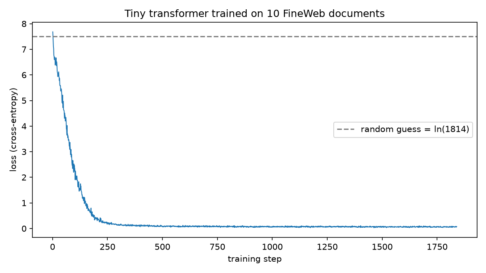

# From internet text to an AI assistant: exam notes

These are my study notes for the oral exam. For each step: **what I did**, **how the AI helped and why it did it that way**, **what my results showed**, and **what it means for business**.

> **How the work was split:** Claude (Claude Code) wrote the code and explained the concepts. **I ran every script myself** on my own Mac, so all numbers and outputs here come from my local run, not from the AI.

**Status:** All 7 steps done. Remaining: put everything in a GitHub repository and share the link.

---

## The big picture in one paragraph

An LLM is built in stages. **(1) Pre-training:** read huge amounts of internet text and learn to **predict the next token**. The result is a *base model* that continues documents. **(2) Post-training / fine-tuning:** train further on example conversations (and with reinforcement learning) so it behaves like a helpful *assistant*. **(3) Inference:** the finished, frozen model is used, and nothing in its weights changes. Everything it "knows" comes from patterns in the training data, so it can be fluent and still wrong.

| Step | Stage of the real pipeline | One-line lesson |
|---|---|---|
| 1. Training data | Data collection | The model only knows what's in its data, up to the date it was collected |
| 2. Text representation | Tokenization | Models see numbers (tokens), never letters |
| 3. Train a small model | Pre-training | Training = next-token prediction; low loss can mean memorization |
| 4. Base vs assistant | Post-training | Base models continue text; assistants answer |
| 5. Fine-tuning data | Supervised fine-tuning | Example conversations teach the assistant style |
| 6. Hallucinations and tools | Limits and fixes | Predicting text ≠ checking facts or doing maths |
| 7. Run locally | Inference | A model is just a file of weights you can run anywhere |

---

## Step 1: Training data

### What I did
1. Looked at the **FineWeb topic map** (FineWeb is a real, public pre-training dataset of cleaned web pages, about 15 trillion tokens).
2. Downloaded **10 documents** as `fineweb_sample.json`.
3. Extracted only the `text` fields, replaced line breaks with spaces, and joined everything into one block: `fineweb_corpus.txt` (**22,044 characters**).

### How the AI did it and why
- **It used code, not "reading and retyping".** A short Python script loaded the JSON, took `row["text"]` from each of the 10 rows in their original order (`row_idx` 0–9), replaced `\n` with a space, and joined them with `" "`.
  - **Why code:** an LLM asked to "copy out" text can silently change, skip or summarize words. Code copies exactly. *(This is the same lesson as Step 6: use tools for exact work.)*
- **It dropped the metadata** (`url`, `date`, `id`, `language_score`, `token_count`), because pre-training uses the raw text stream.
- **It checked the result:** 10 documents, 22,044 characters, 0 line breaks left, UTF-8.

### What my data actually contained
A soap-opera forum post, an angry blog rant about creationism, cancer news headlines, a blog about sharing trash cans, a grocery-industry article on product recalls, a college running report, Kraft launching "Philadelphia with Cadbury", a members-only login page, a restaurant health inspection, and an artist's news page.

### Key observations
- **It's messy:** a login page and menu fragments made it through FineWeb's filtering.
- **It's old:** every document is from the crawl `CC-MAIN-2013-20` (**May 2013**). A model trained on only this would know nothing after 2013.
- **Nothing is labelled true or false:** the rant and the news article count the same. The model learns what text *looks like*, not what is *correct*.

### Exam angle
> **Q: How could a model's training data affect its market analysis?**
> Training data describes the past, up to a cutoff date (my sample stops in May 2013). Anything that happened later (new competitors, prices, regulation) is missing. The data also mixes reliable and unreliable sources with no labels. So market analysis needs fresh, trusted information given to the model, for example by uploading reports or searching.

---

## Step 2: Text representation (bits, bytes, tokens)

### What I did
- First sentence (up to the first full stop):
  `|Viewing Single Post From: Spoilers for the Week of February 11th| |Lil||Feb 1 2013, 09:58 AM| Don't care about Chloe/Taniel/Jen-Jen.`
- **CyberChef → binary:** `fineweb_bits.txt`, which has **133** groups of 8 bits and starts `01111100 01010110 …`
- **CyberChef → decimal:** `fineweb_bytes.txt`, which has **133** numbers and starts `124 86 105 101 …` (= `| V i e`)
- **Tiktokenizer (GPT-4o)** on the whole corpus: `fineweb_tokens.txt`, with **4,731 token IDs**.

### How the AI helped and why
- TextEdit saved my token list as **RTF** (rich text), which wraps the numbers in hidden formatting code (`{\rtf1\ansi…}`). The AI converted it to **plain text** with macOS's `textutil`, then checked that the file contained only numbers, commas and spaces (4,731 IDs).
  - **Why:** a program reading the file would treat the formatting code as data and crash, or worse, read wrong numbers.

### The three levels

| Level | Example | "Alphabet" size | Length for my corpus |
|---|---|---|---|
| Bits | `01111100` | 2 | 22,044 × 8 ≈ 176,000 bits |
| Bytes | `124` | 256 | 22,044 bytes (plain English: 1 byte per character) |
| Tokens | `91` | about 200,000 (GPT-4o, `o200k_base`) | **4,731 tokens** |

**Trade-off:** a bigger alphabet gives a shorter sequence. Models can only look at a limited number of tokens at once (the **context window**), so shorter is better. Tokenization (Byte-Pair Encoding) merges frequent byte sequences, like `" the"`, `"ing"` or `" February"`, into single tokens.

### Key observations
- **About 4.7 characters per token** (22,044 / 4,731).
- The same character gets **different numbers** in different systems: `|` is byte **124** but token **91**.
- **Special characters cost more:** `€` is **3 bytes** (`226 130 172`), and my corpus contains `€ £ ’ “ ” — °`.
- A **space usually belongs to the next word** (`" care"` is one token).
- **Numbers split oddly:** " 11th" became `220, 994, 404` (space / "11" / "th"). Token 220 is a lone space.
- Capitalization matters: `hello`, `Hello` and `HELLO` are different tokens.

### Exam angle
> **Q: What does the model actually read?** A sequence of token IDs (numbers). It learns patterns between those numbers; it never sees letters.
>
> **Q: Why do LLMs struggle to count letters or do arithmetic?** A word like "strawberry" is a few chunks, not letters, and numbers are split into irregular pieces. So letter-counting and digit-by-digit maths don't match how the model sees text. (Tested in Step 6.)
>
> **Business:** API prices and context limits are counted in **tokens**. Text with many symbols, or in languages the tokenizer handles less efficiently, uses more tokens, so it **costs more and fills the context window faster**.

---

## Step 3: Train a small model (pre-training in miniature)

### What I did
1. The AI wrote `requirements.txt`, `model.py` and `train.py`. I installed the packages in a virtual environment (`.venv`) and ran `python train.py`.
2. Then `sky_test.py` (complete "The sky is" 100×) and `corpus_test.py` (complete a sentence from the corpus 100×).

### How the AI built it and why

| Design choice | What it does | Why |
|---|---|---|
| **Validate tokens first** | Re-tokenizes the corpus with `tiktoken` (`o200k_base`) and compares with my Tiktokenizer file | Makes sure training uses the right numbers. **Mine matched exactly.** |
| **Compact vocabulary** | Keeps only the **1,814** token IDs that occur in my corpus, renumbered 0–1,813, and maps them back for printing | A table for 200,000 tokens would be huge and mostly unused. This keeps the model small. |
| **Tiny transformer** | 4 layers, 4 attention heads, 128-number vectors, sees **64 tokens** at a time, about **1.3 million parameters** (GPT-4-class models: hundreds of billions or more) | Small enough to train on a laptop CPU in 60 seconds |
| **Causal mask** | Each position can only "look" at earlier tokens, never later ones | Otherwise the model could cheat by looking at the answer |
| **Random initialization** | Starts with random weights | Shows the model starts knowing nothing |
| **Loss = cross-entropy** | Measures how surprised the model is by the real next token | Training means reducing this surprise |
| **Optimizer (AdamW)** | Nudges every weight slightly in the direction that lowers the loss | This "nudging" is what training means |
| **Batches of 16 × 64 tokens** | Each update looks at 16 random 64-token snippets | Faster and more stable learning |
| **Same prompt + same seed for every sample** | "The company is", seed 42 | The dice rolls are identical, so **any change in the text comes from learning only** |
| **Sampling time not counted** | The 60 s budget counts training only | A fair measure of tokens/second |
| **Saves everything** | `training_log.csv`, `loss_plot.png`, `samples.txt`, `model.pt` | Evidence, and the saved model is reused for testing |
| **AI wrote the code but didn't run it** | I ran it locally | Results are real, not invented by an AI |

### My results

**Training:** **1,839 steps** in 60 s, about **31,000 tokens/second**, about **1.88 million tokens** processed in total (1,839 × 16 × 64), so the model saw my 4,731-token corpus about **400 times**. No wonder it memorized it.

| Step | Loss | Meaning |
|---|---|---|
| 1 | **7.68** | About a random guess: ln(1,814) = 7.50, i.e. choosing evenly among all tokens |
| 100 | 2.38 | Has learned common patterns (`the`, `,`, `.`) |
| 200 | 0.42 | Mostly predicts correctly |
| 1,839 | **0.07** | Almost never surprised, because it has **memorized** the corpus |

*How to read loss:* e^loss ≈ how many tokens the model is effectively choosing between. e^7.68 ≈ 2,170 (anything) versus e^0.07 ≈ 1.07 (essentially one option).

**Samples from "The company is" (same seed every time):**
- **Step 0 (random):** "The company is which skin convenient mediaI gomor cold writes foods provided…": random vocabulary.
- **Step 100:** "…place finish second industryI is supporting the breakfast writes foods (138…": fragments of real documents.
- **Step 1,839 (trained):** "The company is bringing together two of suppliers to subscribe to the exchange by July 1. Michael Roberson, director of corporate quality assurance for Publix Super Markets,". This starts in the **Kraft** article and **jumps** into the **food recall** article.
- **Step 1,780:** "The company is bringing together, butI was wrong" a pathological feature of Creationists?". Kraft mixed with the creationism rant.

### Test 1: "The sky is…" failed

| Token | ID | In my model? |
|---|---|---|
| `The` | 976 | ✅ |
| ` sky` | 17307 | ❌ |
| ` is` | 382 | ✅ |

"sky" appears **0 times** in my 10 documents. The model has one input slot (embedding) per known token, so `" sky"` **cannot even be fed in**. The script saved this explanation in `sky_completions.txt`.

- **Real models don't fail like this.** Any text can be broken into GPT-4o's 200,000 tokens. But a token that was **rare** in training gets little learning, and the model will still write fluently about it. That's where confident mistakes come from.

### Test 2: a sentence from the corpus

- **Chosen:** "If youve done it, better admit it to Harvard now, apologize, and move on." (from the blog rant)
- **Beginning:** "If youve done", which appears **once** in the corpus.
- **Results:** 46/100 continued the real sentence; 45/100 were different from each other.

| Count | Completion |
|---|---|
| 43 | "…admit it to Harvard now, apologize, and move on. **A novel two-step immun…**" |
| 9 | "…admit it to Harvard **in private emails, "Im sorry, I shouldnt have been…**" |
| about 48 | Start correctly, then jump into recall, cancer, trash-can or restaurant text |

**Three lessons:**
1. **Memorization:** with tiny data, the most likely continuation is the one the model saw, copied word for word (43×).
2. **No document boundaries:** after "move on." it continues with "A novel two-step immun…", the start of the **next document** (cancer news). The documents were joined with only a space, so the model thinks they belong together. Real training adds a special **end-of-text token** between documents.
3. **How hallucination works:** "to Harvard **in private emails**" also appears elsewhere in the rant. After "Harvard" the model has seen two continuations and sometimes picks the other. Every piece is real text, but the sentence it produces was never written. Stranger examples join the rant to the food-recall article.

### Exam angle
> **Q: What is training?** Repeatedly showing the model text, letting it predict the next token, measuring the error (loss), and adjusting the weights to reduce it. My model went from loss 7.68 to 0.07 in 1,839 updates.
>
> **Q: Does uploading a company report change the model's weights?** No. Weights change only during training (my 60 seconds). Afterwards `model.pt` is frozen; using it is **inference**. An uploaded report is only added to the **context** for that conversation.
>
> **Q: Why might a model confidently invent a supplier's history or a source?** It predicts likely continuations. Where several fit, it picks one and keeps going fluently, as my model joined a blog rant to a food-recall article. Nothing checks the facts. Low loss ≠ truth.
>
> **Q: Why can a model be weak on a niche topic?** It can only draw on what was in its training data. My model couldn't even read "sky". Big models don't fail visibly, but they are weakest where data was thin. **Fix:** provide the relevant documents in the context (RAG, uploads, search).

---

## Steps 4–7

### Step 4: Base model vs assistant ✅ (full results in `step4_base_vs_assistant.md`, screenshots in `step4_screenshots/`)

**Setup:** [SLM Testing](https://stanley-00-slm-testing.hf.space/) on CPU (with "Use GPU" ticked the site crashed). Same size for both: 135 million parameters.

**4.1–4.2: Base vs assistant (3 runs each)**

| | Base `SmolLM2-135M` (Completion) | Instruct, by accident in Completion | **Instruct `SmolLM2-135M-Instruct` (Chat)** |
|---|---|---|---|
| "What is 2+2?" | **No output** 3/3 | **No output** 3/3 | **Answers** 3/3; says "4" in 2/3 |
| Paris list | Continues the list | Long list with descriptions | **Replies to me**: "Here's your top 10 list…" |

- **Base model = continues documents.** A lone question isn't a good document start, so it added nothing. The Paris list is a document shape, so it continued it (with repeats: Arc de Triomphe 3× in one run).
- **Assistant = same model + post-training on conversations + chat template.** Chat mode wraps my text in special tokens (system / user / assistant), the format it saw during post-training. **Without the template (Completion mode) the Instruct model behaved like the base model.**
- **Post-training changes behaviour, not knowledge:** the assistant explained 2+2 with "coins and nickels" and wrote "four plus four equals sixty". The Paris answers were fluent but invented: the Arc de Triomphe honours "President Louis Philippe de brandt", the "Orsay Opera House", the Louvre contains "the Prado Museum", Sacré-Cœur is "on the Île de la Cité".

**4.3: Prompting a base model to act as an assistant**
- **Plain "Why is the sky blue?":** it wrote an FAQ page with a wrong explanation (rainbows, prisms), then **invented the next question** ("Is there a sunrise every day?").
- **Inside a fake `Human:` / `Assistant:` conversation:** all 3 runs answered **in the assistant role**, in the short style of my examples. Run 2 was correct ("light from the sun scatters off the atmosphere"). Same weights; only the **context** changed.
- **But it never stopped:** it wrote the next `Human:` questions and answered them too ("two planets in our solar system — Mercury and Venus", "the Moon orbits the Earth once every year"). It continues a *transcript*, writing both sides. Post-training teaches a model to stop at the end of its turn.

**4.4: Knowledge cutoff**

| Prompt | Model said | Truth |
|---|---|---|
| 2020 Nobel (Economics) | "three economists … international economy" + invented statistics | Paul Milgrom and Robert Wilson (auction theory) |
| 2026 Nobel (Economics) | "**Robert Mundell**, University of Chicago" | Robert E. Hall and Michael Woodford (12 Oct 2026) |

- 2020 was before training, but a 135M model is too small to remember it.
- 2026 is **after the cutoff**. It didn't say "I don't know"; it named a real economist who won in **1999** (and died in 2021). It filled the sentence with a likely-sounding name.

**Exam angle**
> **Q: Why might a base model continue a customer's question instead of answering it?** My base model gave **no answer** to "What is 2+2?" three times, and with "Why is the sky blue?" it wrote an FAQ and invented the next question. It learned to continue documents. Post-training on conversations (in a chat format) teaches the assistant version to respond, and to stop.
>
> **Q: How could training data affect market analysis?** Knowledge stops at the cutoff. My model confidently named the **1999** winner as the **2026** winner. Ask about this quarter's market and you may get last decade's facts in today's wording. Recent information must come from search or documents.
>
> **Business:** post-training makes a model *pleasant to use*, not *correct*. The assistant explained 2+2 with coins in the tone of a teacher. A confident tone is not evidence.

### Step 5: Supervised fine-tuning ✅ (`oasst_sample.json` → `extract_conversations.py` → `conversations.json`)

**What I did:** downloaded 100 messages from the **OpenAssistant (oasst1)** dataset and extracted 3 English conversations: a human question plus the answer volunteers **ranked best** (rank 0 of 3 written answers each), saved in the standard chat format (`{"role": "user"}` / `{"role": "assistant"}`).

**How the AI did it and why:** a short script (kept in the repo for transparency) takes `prompter` messages with no parent (= start of a conversation), `lang == "en"`, and the `assistant` reply with `rank == 0`. It uses code rather than copy-paste, so the text is exact.

**How the dataset is built:**
- **Volunteers wrote both sides**: the questions (`prompter`) and the answers (`assistant`, people *pretending to be the ideal assistant*).
- It's a **tree**: one question has several alternative answers, and each answer can have follow-up questions.
- Other volunteers **ranked** the alternative answers (`rank` 0 = best). That's **preference data**, used for RLHF / reward models after SFT.

**My 3 conversations:**
1. "Write a short introduction about the relevance of **monopsony** in economics… cite relevant research" (labour-market example)
2. "Explain **contrastive learning** in simple terms" (cats-vs-dogs example: pull similar pairs together, push different ones apart)
3. "I want to start **astrophotography** as a hobby" (camera, tripod, dark sky, settings)

**Key observations:**
- **This is what an assistant's "personality" comes from:** friendly openings ("Sure! Let's say…"), structure, a concluding sentence. SFT teaches the model to imitate this *style*.
- **Even the best-ranked human answer has a citation problem:** the monopsony answer cites *Bivens & Mishel (2013), "The Pay of Corporate Executives and Financial Professionals as Evidence of Rents in Top 1 Percent Incomes"*. It's a real paper, but it's about **executive pay**, not monopsony in retail and fast food. The citation *looks* right and doesn't support the claim. A model trained on answers like this learns that **answers include citations**, not how to check them. That's one route to invented or mismatched sources.
- **Human data has noise:** in the first rows I also saw assistant answers unrelated to their question (one about the painter Bouguereau under a monopsony question).
- **Scale:** I saved 3 conversations; real SFT uses tens of thousands to millions. Technically it's the **same next-token prediction as my Step 3 model**, but on conversations in the chat template, and usually only the **assistant's tokens** count toward the loss.

**Exam angle**
> **Q: How does a base model become an assistant?** Supervised fine-tuning on example conversations written by people (like OpenAssistant). Same training method as pre-training (predict the next token), different data, so the model learns to *respond* in an assistant's style. Rankings of alternative answers are then used for RLHF.
>
> **Q: Why might a model confidently invent a source for a business claim?** It imitates human-written answers. Even the best-ranked answer in my sample attached a real but **irrelevant** paper to its claim. The model learns the *pattern* "claim + (Author, Year)", and when it lacks the fact it fills the pattern with plausible details. Check every source it gives.

### Step 6: Hallucinations, thinking and tools ✅ (full results in `step6_results.md`; answer key `step6_answer_key.py`)

All tests in **claude.ai**, a new chat per test. Models: **Claude Opus 5.5** (Effort Medium/High) and **Claude Opus 3** (2024, no thinking mode).

**6.1: Obscure article (Mori et al. 2025, *Personnel Review*, AI in recruitment ethics)**

| Q | Without the article ("answer from your own knowledge only") | With the PDF attached |
|---|---|---|
| 1. Articles reviewed (120) | ❌ "51" | ✅ 120 (+ 1,492 before screening) |
| 2. Databases (WoS + Scopus) | ✅ "the standard pair" | ✅ |
| 3. Ethical theories (utilitarian, justice, rights) | ❌ utilitarianism, deontology, virtue ethics ("fairly sure") | ✅ (+ "following Cavanagh et al.") |
| 4. SHRM 2022 share (79%) | ✅ widely repeated statistic | ✅ |
| 5. Journal guide (CABS 2021) | ✅ "inferring from what is standard" (+ an invented "2 stars or higher") | ✅ |
| **Score** | **3/5** | **5/5** |

- It knew the paper's **exact title** but not its details. The correct answers came from **common patterns** or **widely repeated facts**; the paper-specific details (Q1, Q3) were wrong. Confidence was highest on a wrong answer (Q3).
- First attempt with web search ON: it **searched by itself** and answered correctly with sources. Retrieval = putting the evidence in the context.
- With the PDF it "ran 2 commands" to read it (a tool) and was exact. **Same model, same weights: only the context changed.**

**6.2: "Who created you?"**
- **Claude Opus 5.5:** "I was made by Anthropic… Claude Opus 5.5" ✅ (matches the model picker and Anthropic's docs). Identity is trained in during post-training and/or stated in the system prompt.
- **SmolLM2-135M-Instruct:** "I'm a descendant of… Gaius Julius Caesar of London, born in 1846 in Stoke-on-Trent" ❌ (the model card says Hugging Face). It didn't even treat itself as an AI and continued like a personal memoir.
- → A model's statements about itself are predicted text. Check the documentation.

**6.3: Retailer profit (correct: €930.46, verified with Python)**

| Model | "Final answer only" | "Show the calculation" |
|---|---|---|
| Opus 3 (non-thinking) | ✅ €930.46, but **ignored the instruction** (reasoned out loud) and rounded intermediate amounts | ❌ **−€610.34**: subtracted the 72 returned units from the unsold stock (140 instead of 212) |
| Opus 5.5 High (thinking) | ✅ just "€930.46" (worked in a hidden thinking phase) | ✅ full precision; explicitly said the returned units aren't added back |

- The one wrong answer was a **logic error, not arithmetic**: every multiplication was right, but one step turned a profit into a loss, and it looked as convincing as a correct answer.
- **Same model, different answers** (Opus 3: right, then wrong), since outputs are sampled.
- **Thinking = extra tokens to work in before answering.** A non-thinking model can only reason out loud; a thinking model has a hidden scratchpad and was trained with RL on checkable problems like this.
- Caveat: Opus 3 vs 5.5 also differ in generation (2024 vs 2026); 2 runs each.

**6.4: 9.11 vs 9.9, r's in strawberry, every 3rd letter of Ubiquitous (correct: 9.9 / 3 / Uqts)**
- **Without code: 3/3 ✅.** These are famous LLM failures, now in training data and targeted in post-training; the model also spelled out steps ("9.9 = 9.90"; positions 1, 4, 7, 10).
- **With code: 3/3 ✅**, with executed Python: `max(9.11, 9.9)`, `"strawberry".count("r")`, `"Ubiquitous"[::3]`.
- Without code it's right because it **learned these cases**; with code it's right **by construction**. It still sees tokens, not letters, so less famous variants can still fail.

**Exam angle**
> **Hallucinations:** without the article the model said 51 articles instead of 120 and gave the textbook ethical theories instead of the paper's, while correctly recalling the title. It fills familiar answer patterns with plausible details.
>
> **Context and tools:** the same model went from 3/5 to 5/5 when the article was in the context (upload or search). Give the model the actual report.
>
> **Calculations:** Opus 3's step-by-step calculation contained one wrong logical step and showed a €610 loss instead of a €930 profit. Fluent ≠ correct. Executed code calculates exactly.
>
> **Reinforcement learning:** arithmetic has answers code can check, so it can be rewarded automatically. That's what makes thinking models better at calculations like 6.3. A "good sales email" has no automatic checker, so the reward is harder to define.

### Step 7: Run a model locally ✅ (`local_model.png`)

**What I did:** installed **LM Studio 0.4.28** (classic app from lmstudio.ai/download; the homepage now promotes "LM Studio Bionic", their agent app, which I didn't use). Skipped the suggested Gemma 4 E4B (6.86 GB) and downloaded **`lmstudio-community/Llama-3.2-1B-Instruct-GGUF`, file `Llama-3.2-1B-Instruct-Q8_0.gguf` (1.32 GB)**, then loaded it and asked "Tell me a joke about a pelican."

**Answer (model `llama-3.2-1b-instruct`):** "Why did the pelican go to therapy? Because it had a **fowl** temper! (get it?)"

**What the labels mean:**
- **Llama 3.2 1B Instruct**: Meta's model, 1 billion parameters, the instruction-tuned (assistant) version, like SmolLM2-Instruct in Step 4.
- **GGUF**: a file format for running models on ordinary computers.
- **Q8_0**: **quantization**, each weight stored in 8 bits instead of 16/32, so the file is smaller and faster with little quality loss. That's how 1B parameters fit in about 1.3 GB.
- **Full GPU offload**: the whole model fits on my Mac's GPU (Apple M5, 16 GB).

**Observations:**
- **The model is one file of weights** (about 1.2 GB on disk, in `~/.lmstudio/models/…`), the same idea as my 5 MB `model.pt` from Step 3, just about 250× bigger. Loading = putting the weights into memory; chatting = **inference** on my own Mac.
- **The joke:** a standard template ("Why did X go to therapy?") plus a generic bird pun (**fowl**/foul) that would fit any bird. Nothing pelican-specific (no beak or pouch joke). Fluent but generic: a small model reproduces the most common joke patterns.

**Exam angle / business**
> **Local model = privacy + control:** customer data, contracts and financials never leave the company's machines; no per-token API costs; works offline. **Trade-off:** a laptop-sized model (1B) is far less capable than cloud models (my Step 6 tests used Opus 5.5), and the company must handle updates, security and hardware itself. A typical use: small local models for sensitive routine tasks (classification, summaries of internal documents), large cloud models for complex reasoning.

---

## Quick answers to the teacher's example questions

| Topic | Answer |
|---|---|
| **Training data** | It describes the past up to a cutoff (mine: May 2013). Market changes after that need fresh information. |
| **Training vs inference** | Uploading a report doesn't change weights; it adds context. Only training changes weights. |
| **Base vs assistant** | A base model learned to continue documents; post-training on conversations teaches it to answer. |
| **Hallucinations** | The model imitates human-written answers and fills familiar patterns with invented details. Predicting likely text ≠ checking facts. (My model joined a blog to a recall article.) |
| **Context and tools** | Putting the actual report or retrieved information in the context provides evidence, including facts missing from training. |
| **Calculations** | Executed code calculates exactly; a fluent explanation is predicted text, not a calculation. |
| **Reinforcement learning** | Arithmetic answers can be checked automatically, so rewards are easy. A "good sales email" needs human judgment, so the reward is hard to define. |

---

## Glossary

- **Token:** a chunk of text (word, part of a word, symbol) with an ID number. GPT-4o has about 200,000.
- **Tokenizer:** turns text into token IDs and back (`o200k_base` for GPT-4o).
- **Vocabulary:** the set of tokens a model knows (mine: 1,814).
- **Parameters / weights:** the numbers inside the model that training adjusts (mine: about 1.3 million).
- **Loss:** how surprised the model is by the correct next token. Lower = better predictions.
- **Pre-training:** learning next-token prediction on large amounts of text, which produces a base model.
- **Post-training / fine-tuning:** further training on conversations (and RL) to make an assistant.
- **Inference:** using a trained model; weights don't change.
- **Context window:** how many tokens the model can see at once (mine: 64).
- **Memorization vs generalization:** copying training text vs learning patterns that work on new text.
- **Hallucination:** fluent, confident output that isn't true.
- **Seed:** a starting number for randomness. Same seed = same "dice rolls".
- **End-of-text token:** a special token marking where one document ends. My corpus lacked it, so the model blended documents.

---

## My files

| File | Step | What it is |
|---|---|---|
| `fineweb_sample.json` | 1 | 10 raw FineWeb documents |
| `fineweb_corpus.txt` | 1 | Their text joined into one block |
| `fineweb_bits.txt` | 2 | First sentence as bits |
| `fineweb_bytes.txt` | 2 | First sentence as bytes |
| `fineweb_tokens.txt` | 2 | GPT-4o token IDs for the corpus |
| `requirements.txt`, `model.py`, `train.py` | 3 | Training code |
| `results/` | 3 | `training_log.csv`, `loss_plot.png`, `samples.txt`, `model.pt` |
| `sky_test.py`, `sky_completions.txt` | 3 | "The sky is" test (failed: no " sky" token) |
| `corpus_test.py`, `corpus_completions.txt` | 3 | Corpus-sentence test (memorization and mixing) |
| `step4_base_vs_assistant.md` | 4 | All Step 4 outputs, fact checks and observations |
| `step4_screenshots/` | 4 | 24 screenshots (base, Instruct in Completion, Instruct in Chat, sky blue, Nobel) |
| `oasst_sample.json` | 5 | 100 raw OpenAssistant messages |
| `extract_conversations.py`, `conversations.json` | 5 | 3 question + best-ranked-answer conversations |
| `step6_results.md`, `step6_answer_key.py`, `step6_screenshots/` | 6 | All Step 6 tests, the code-computed correct answers, screenshots |
| `local_model.png` | 7 | LM Studio screenshot: Llama 3.2 1B Instruct telling a pelican joke |
